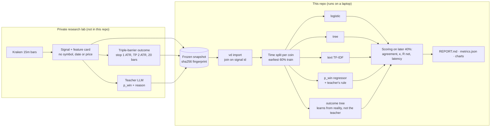
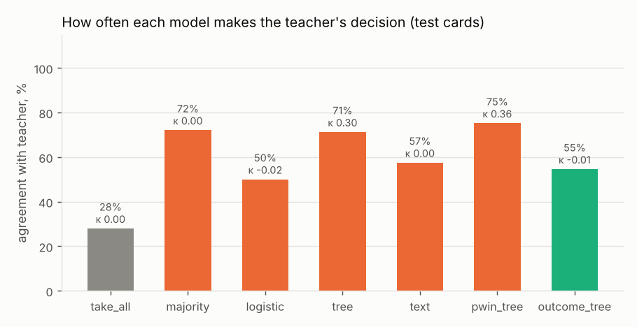
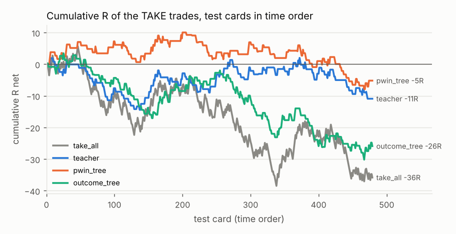

# LLM veto distillation

**Can a millisecond-fast table model copy a large language model's trading veto, and is the veto worth copying?**

A rule-based strategy fires trade signals on 15-minute crypto bars. Before each trade, an LLM
(the *teacher*, `gemini-2.5-flash`) reads a short "feature card" describing the signal and
estimates its chance of hitting the take-profit; a fixed rule turns that into **TAKE** or
**DONT_TAKE**. That costs an API call and about a second per signal. This repo trains small
*students* (logistic regression, gradient-boosted trees, a text model) to reproduce the
teacher's decisions from the same card, then measures two separate things:

1. **Distillation:** how often does the student make the teacher's decision, and how much faster is it?
2. **Usefulness:** do the TAKE trades make money after costs, compared with taking every signal?

A student can copy the teacher perfectly and still lose money, if the teacher does. Keeping
the two questions apart is the point of the project.

> **Status:** the pipeline, tests and synthetic demo are complete. The real-data run uses a
> frozen snapshot of the upstream teacher answers and is [pending](#results); the teacher's own
> results on real data are already known and are reported below, including the bad parts.

## Architecture



## What a card looks like

The teacher and every student see only this (numbers are relative, so the coin and era
cannot be identified). The outcome is never on the card. (Illustrative values.)

```
Signal: SHORT, 15m bars. StochRSI K 99.0 -> 92.9 (turn out of overbought).
Volatility: ATR(14) = 0.56% of price; rank 6/100 over the last 30 days.
Cost: round-trip fee = 10% of the 1-ATR risk.
Trade plan: stop 1 ATR, take-profit 2 ATR, max 20 bars.
Trend: price vs EMA50 -1.20 ATR, vs EMA200 -2.34 ATR; EMA50 below EMA200.
Location: price vs daily VWAP +0.85 ATR; position in last 20 bars' range 62/100.
Last 4 bar moves (ATR, oldest first): +0.31, -0.12, +0.44, -0.27.
RSI(14) 66; volume 1.4x its 20-bar average.
Time: 14:00 UTC (US session).
Answer: TAKE or DONT_TAKE, win probability 0-1, reason in at most 40 words.
```

## Key design decisions

- **Teacher gives a probability, a rule decides.** The LLM estimates `p_win`; TAKE when the
  expected R after fees is positive (`2p − (1 − p) − fee > 0`). An earlier prompt that let the
  LLM decide directly anchored on one answer, so the decision was moved into code.
- **Two questions, two metric sets.** Agreement and Cohen's κ for copying; win rate, mean R
  net per trade (with standard error) and cumulative R for usefulness. κ matters because a
  teacher that says TAKE 87% of the time is "copied" 87% of the time by a constant.
- **No look-ahead.** Cards use only bars closed at the signal; students train on the earliest
  60% of each coin's cards and are scored on the later 40%, so no test card precedes a training
  card of the same coin.
- **A reference that skips the teacher.** `outcome_tree` is the same tree trained on real
  outcomes. If it beats the teacher, the LLM added nothing that the outcomes did not already hold.
- **Costs are in the label.** R net includes a 0.04% per side fee and funding; trades whose fee
  exceeds 10% of the risk are never sent to the teacher.
- **Reproducible snapshot.** `vd import` writes a sha256 manifest of its inputs and output;
  every report prints the dataset fingerprint.
- **Untouched final test.** Upstream, all data from 2025 onwards is sealed for a one-shot
  evaluation; nothing here reads it.

## Results

### The teacher on real data (upstream, already measured)

Latest 30% of fee-filtered dev signals (ADA 2022, BTC 2021–22), mean R net per trade after costs:

| decision maker | ADA trades | ADA R net | BTC trades | BTC R net |
|---|---|---|---|---|
| take every signal | 574 | −0.116 | 609 | −0.049 |
| skip 02–08 UTC (simple hour rule) | 443 | −0.070 | 477 | +0.000 |
| gradient-boosted tree on the card | 251 | −0.077 | 165 | −0.037 |
| **Gemini, p_win + rule** | 503 | **−0.090** | 522 | **−0.036** |
| Gemini, thinking on, decides itself | 216 | −0.243 | 219 | −0.116 |

**What didn't work:** the teacher adds no edge over simple references. The p_win variant
takes ~87% of signals and lands close to "take everything"; the thinking variant picks trades
that win *less* often than average (ADA 25.9% vs 29.6%). The card's fields carry little signal
(a tree on them scores AUC 0.51–0.54). So the honest expectation for the student is: it can
learn to copy the teacher cheaply, but copying it is not worth money.

### Students on real data

Pending the frozen snapshot run (`results/real/`). This section will hold the agreement, κ,
speed and R-net table and the charts from that run, whatever they show.

### Synthetic demo (pipeline check only)

`vd demo` runs everything on made-up cards with a hand-written heuristic teacher, so anyone
can run it without data or keys. These numbers say nothing about markets or LLMs.
Full output: [`results/synthetic/REPORT.md`](results/synthetic/REPORT.md).

| model | agreement with teacher | κ | R net / trade |
|---|---|---|---|
| take every signal | 27.9% | 0.00 | −0.075 ± 0.061 |
| teacher | 100% | 1.00 | −0.081 ± 0.117 |
| `pwin_tree` (best student) | 75.2% | 0.36 | −0.102 ± 0.124 |
| `outcome_tree` (no teacher) | 54.6% | −0.01 | −0.130 ± 0.098 |

The best student runs in under 1 ms per card vs ~1.3 s for an API call.




## How to run

[](https://colab.research.google.com/github/balasbrn/llm-veto-distillation/blob/main/notebooks/colab.ipynb) — or locally:

```bash
make install          # Python 3.11+; numpy, scikit-learn, matplotlib (+ pyarrow for import)
make test             # 19 tests, synthetic data only
make demo             # full pipeline on synthetic data -> results/synthetic/
```

With a snapshot of real teacher answers in a local folder:

```bash
vd import --data-root ~/llm-veto-data \
          --source ADA:ADAUSD:dev --source BTC:XBTUSD:dev-long \
          --run gemini-2.5-flash-v2-think0 --out data/teacher_labels.jsonl
vd run --data data/teacher_labels.jsonl --out results/real --title "Real data: Gemini v2 teacher"
```

Expected snapshot layout: `h16/cards/<PAIR>/<period>/cards.parquet` (card fields, outcome,
R net) and `h16/teacher/<PAIR>-<period>-<run>.jsonl` (one teacher answer per line).

## Tech stack

Python · scikit-learn (logistic regression, histogram gradient boosting, TF-IDF) · NumPy ·
Matplotlib · PyArrow · pytest · GitHub Actions. Teacher: Gemini 2.5 Flash via Vertex AI
(optional `teacher` extra; not needed to run anything here).

## Layout

```
src/veto_distill/
  card.py        card fields, card text, feature vector
  cmf_import.py  join upstream cards + teacher answers into one dataset
  teacher.py     prompt, answer parser, decision rule, optional Gemini call
  students.py    the students and the outcome reference
  evaluate.py    split, agreement, κ, R net, calibration, latency
  plots.py       charts
  report.py      REPORT.md + metrics.json
  synthetic.py   synthetic cards and heuristic teacher for tests and the demo
tests/           19 tests
notebooks/       colab.ipynb: demo + real-data run in Colab
results/         reports (synthetic now, real when run)
```

## What is left out

- **Market data, cards and teacher answers.** They come from a private research repo and are
  never committed; only aggregate metrics and charts are.
- **Keys and cloud details.** Nothing here needs credentials; the optional Gemini call reads
  your own project from the environment.
- **The signal research itself** (StochRSI event study, labelling, challenge simulator) and the
  sealed 2025+ evaluation, which live upstream.
- **An LLM student.** The original plan included a 1.5B-parameter local model as a student; this
  repo uses table and text models, which train in seconds and are enough to answer the question.
