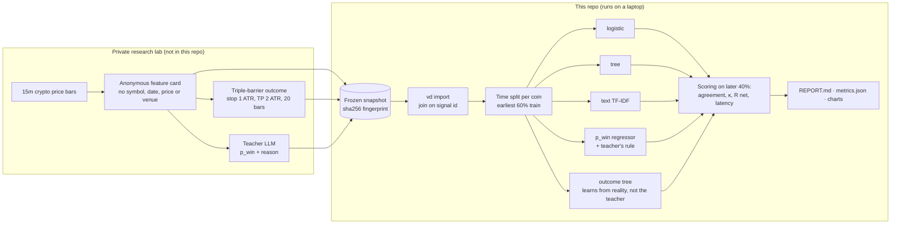
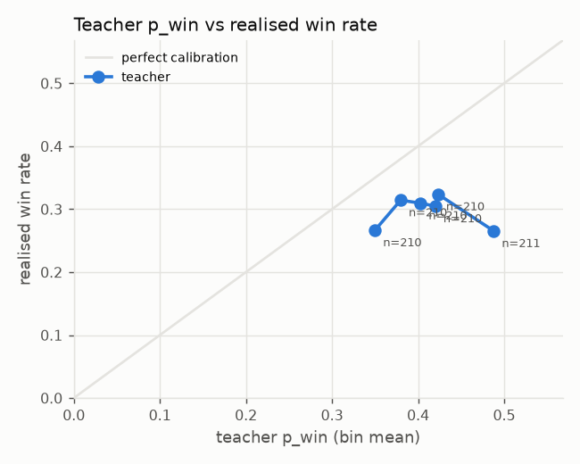
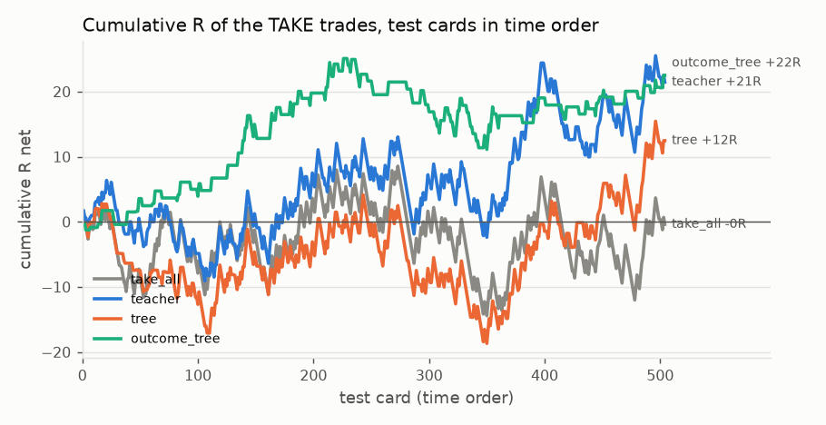

# LLM veto distillation

**Can a millisecond-fast table model copy a large language model's trading veto, and is the veto worth copying?**

A rule-based strategy fires trade signals on 15-minute crypto bars. Before each trade, an LLM
(the *teacher*, `gemini-2.5-flash`) reads a short "feature card" describing the signal and
estimates its chance of hitting the take-profit; a fixed rule turns that into **TAKE** or
**DONT_TAKE**. That costs an API call and about a second per signal. This repo trains small
*students* (logistic regression, gradient-boosted trees, a text model) to reproduce the
teacher's decisions from the same card, then measures two separate things:

1. **Distillation:** how often does the student make the teacher's decision, and how much faster is it?
2. **Usefulness:** do the TAKE trades make money after costs, compared with taking every signal?

A student can copy the teacher perfectly and still lose money, if the teacher does. Keeping
the two questions apart is the point of the project.

> **Status:** pipeline, tests, synthetic demo and the real-data run are done. Students copy
> the teacher moderately (κ ≈ 0.4–0.5) at ~3 ms per card instead of ~1–5 s per API call; on
> these few hundred test cards no decision maker shows a measurable edge (see [Results](#results)).

## Architecture



## What a card looks like

The data is anonymous by design: the teacher and every student see only this card, where
every number is relative (ATR units, %, ranks), so the coin, venue and era cannot be identified. The outcome is never on the card. (Illustrative values.)

```
Signal: SHORT, 15m bars. StochRSI K 99.0 -> 92.9 (turn out of overbought).
Volatility: ATR(14) = 0.56% of price; rank 6/100 over the last 30 days.
Cost: round-trip fee = 10% of the 1-ATR risk.
Trade plan: stop 1 ATR, take-profit 2 ATR, max 20 bars.
Trend: price vs EMA50 -1.20 ATR, vs EMA200 -2.34 ATR; EMA50 below EMA200.
Location: price vs daily VWAP +0.85 ATR; position in last 20 bars' range 62/100.
Last 4 bar moves (ATR, oldest first): +0.31, -0.12, +0.44, -0.27.
RSI(14) 66; volume 1.4x its 20-bar average.
Time: 14:00 UTC (US session).
Answer: TAKE or DONT_TAKE, win probability 0-1, reason in at most 40 words.
```

## Key design decisions

- **Teacher gives a probability, a rule decides.** The LLM estimates `p_win`; TAKE when the
  expected R after fees is positive (`2p − (1 − p) − fee > 0`). An earlier prompt that let the
  LLM decide directly anchored on one answer, so the decision was moved into code.
- **Two questions, two metric sets.** Agreement and Cohen's κ for copying; win rate, mean R
  net per trade (with standard error) and cumulative R for usefulness. κ matters because a
  teacher that says TAKE 87% of the time is "copied" 87% of the time by a constant.
- **No look-ahead, with a purge.** Cards use only bars closed at the signal. Students train on
  the earliest 60% of each coin's cards and are scored on the later 40%. Each outcome runs
  20 bars (5 hours) past its card, so training cards within **one day** of the first test card
  are dropped; otherwise the last training labels would contain test-period prices.
- **A reference that skips the teacher.** `outcome_tree` is the same tree trained on real
  outcomes. If it beats the teacher, the LLM added nothing that the outcomes did not already hold.
- **Costs are in the label.** R net includes a 0.04% per side fee and funding; trades whose fee
  exceeds 10% of the risk are never sent to the teacher.
- **Reproducible snapshot.** `vd import` writes a sha256 manifest of its inputs and output;
  every report prints the dataset fingerprint.
- **Untouched final test.** Upstream, all data from 2025 onwards is sealed for a one-shot
  evaluation; nothing here reads it.

## Results

### The teacher on real data (upstream, already measured)

Scored upstream on the latest 30% of fee-filtered dev signals, from the first full month
(574 ADA and 609 BTC trades), mean R net per trade after costs. This is a **different window**
from the student results below, which score only the latest 40% of the teacher-labelled
cards, so the "take every signal" numbers differ between the two tables.

| decision maker | ADA trades | ADA R net | BTC trades | BTC R net |
|---|---|---|---|---|
| take every signal | 574 | −0.116 | 609 | −0.049 |
| skip 02–08 UTC (simple hour rule) | 443 | −0.070 | 477 | +0.000 |
| gradient-boosted tree on the card | 251 | −0.077 | 165 | −0.037 |
| **Gemini, p_win + rule** | 503 | **−0.090** | 522 | **−0.036** |
| Gemini, thinking on, decides itself | 216 | −0.243 | 219 | −0.116 |

**What didn't work:** the teacher adds no edge over simple references. The p_win variant
takes ~87% of signals and lands close to "take everything"; the thinking variant picks trades
that win *less* often than average (ADA 25.9% vs 29.6%). The card's fields carry little signal
(a tree on them scores AUC 0.51–0.54). So the honest expectation for the student is: it can
learn to copy the teacher cheaply, but copying it is not worth money.

### Students on real data

Two teacher runs, 1,261 teacher-labelled cards each (ADA 632, BTC 629; join counts match the
upstream record). Students train on the earliest 60% of each coin (751 cards after purging 5
at the boundary) and are scored on the latest 40% (505 cards: BTC from late July 2021, ADA from late May 2022, both to the end of 2022).
Full reports: [v2](results/real-gemini-2.5-flash-v2-think0/REPORT.md) (main) and
[v1.1-think1024](results/real-gemini-2.5-flash-v1.1-think1024/REPORT.md) (comparison).

**Distillation works moderately.** κ against the teacher (0 = chance, 1 = perfect copy):

| student | κ, v2 teacher | κ, v1.1-think1024 teacher | ms / card (fit + predict) |
|---|---|---|---|
| `tree` (depth-3 boosted tree on the card's numbers) | **0.41** | **0.49** | ~3 |
| `pwin_tree` (regresses p_win, applies the teacher's rule) | 0.29 | 0.46 | <1 |
| `text` (char n-gram TF-IDF on the card text) | 0.15 | 0.22 | ~2 |
| `logistic` | 0.12 | 0.21 | <0.1 |
| teacher (one API call) | – | – | 1,070 (v2), 5,370 (v1.1) |

Raw agreement looks better than it is: the v2 teacher says TAKE on 84–89% of cards, so
"always TAKE" already agrees 84%, more than any student. That is why κ leads. `pwin_tree`
reproduces v2's p_win to within 0.023 on average (rank correlation 0.72).

**No reliable edge.** Mean R net per trade on the 505 test cards (± one standard error):

| decision maker | v2 run | v1.1-think1024 run |
|---|---|---|
| take every signal | −0.001 ± 0.061 | −0.001 ± 0.061 |
| teacher | +0.051 ± 0.068 (424 trades) | +0.024 ± 0.106 (172) |
| best student (`tree`) | +0.032 ± 0.070 (390) | −0.040 ± 0.104 (175) |
| `outcome_tree` (no teacher) | +0.172 ± 0.124 (131) | same |

The teacher's set is a subset of the same cards, so the fair test is the **paired** difference
from taking every signal. Each report computes it with a bootstrap, and a difference counts
only beyond about 2 SE. The v1.1 teacher (+0.025), every student and `outcome_tree` (about 1.6 SE)
stay inside that. The one borderline case is the v2 teacher's +0.05 R. A rough paired estimate
from the summary numbers puts it near 2 SE, and the bootstrap figure is in the
[v2 report](results/real-gemini-2.5-flash-v2-think0/REPORT.md). Even at 2 SE it is the
better of two teacher runs, on months the teacher may have seen in training. It does not
survive into its students (`tree` +0.033, about 1 SE).

`outcome_tree` has the largest number on the page, but it is about 1.4 SE from zero and the
best of eight rows. That is not significant, and it is not evidence of an edge.

**Why copying adds nothing: the teacher is not calibrated.** v2's p_win runs 0.35–0.49 while
realised win rates are 26–32% in every bin, with no upward slope. The teacher is overconfident
by about 10 points, and its p_win does not rank outcomes. A student can learn to reproduce that
number, but the number carries no information about the trade.

**Limits.** This is small data: Gemini answered only the latest 30% of fee-filtered dev
signals, about 631 cards per coin, which leaves roughly 375 training and 250 test cards per
coin. Also, every card (2018–2022) predates Gemini's training cutoff (believed to be January
2025), so the teacher may have seen these months. Treat all of this as a demonstration of the
method, not as out-of-sample evidence.




### Synthetic demo (pipeline check only)

`vd demo` runs everything on made-up cards with a hand-written heuristic teacher, so anyone
can run it without data or keys. These numbers say nothing about markets or LLMs.
Full output: [`results/synthetic/REPORT.md`](results/synthetic/REPORT.md).

| model | agreement with teacher | κ | R net / trade |
|---|---|---|---|
| take every signal | 27.9% | 0.00 | −0.075 ± 0.061 |
| teacher | 100% | 1.00 | −0.081 ± 0.117 |
| `pwin_tree` (best student) | 75.4% | 0.36 | −0.045 ± 0.126 |
| `outcome_tree` (no teacher) | 55.6% | 0.02 | −0.137 ± 0.096 |

The best student runs in under 1 ms per card vs ~1.3 s for an API call.


## How to run

[](https://colab.research.google.com/github/balasbrn/llm-veto-distillation/blob/main/notebooks/colab.ipynb) — or locally:

```bash
make install          # Python 3.11+; numpy, scikit-learn, matplotlib (+ pyarrow for import)
make test             # 32 tests, synthetic data only
make demo             # full pipeline on synthetic data -> results/synthetic/
```

Colab runs the tests and the synthetic demo. The real-data run reads a private snapshot
from a local folder (the data is not published):

```bash
for RUN in gemini-2.5-flash-v2-think0 gemini-2.5-flash-v1.1-think1024; do
  vd import --data-root ~/llm-veto-data \
            --source ADA:ADAUSD:dev --source BTC:XBTUSD:dev-long \
            --run $RUN --out data/$RUN.jsonl
  vd run --data data/$RUN.jsonl --out results/real-$RUN --title "Real data: $RUN" \
         --teacher-cutoff 2025-01-31
done
```

Each run also writes `per_card.jsonl` (every model's TAKE flag per test card, outcome in its
own fields; ignored by git because it holds real data). Experiments reuse it:

```bash
vd run ... --drop-features atr_pct,atr_rank_30d,fee_pct_of_risk   # same rows, fewer inputs
vd run ... --cutoff 2022-03-01                                     # one shared date split
vd compare results/A/per_card.jsonl results/B/per_card.jsonl --model tree
```

`vd compare` counts missed and extra vetoes against the teacher, the cards the change fixed and
broke (exact two-sided sign test), and then, separately, the trading results.

`vd import` prints the join counts and the report repeats them. Expected teacher lines:
v2 633 (ADA) and 629 (BTC); v1.1-think1024 632 and 630.

Expected snapshot layout: `h16/cards/<PAIR>/<period>/cards.parquet` (card fields, outcome,
R net) and `h16/teacher/<PAIR>-<period>-<run>.jsonl` (one teacher answer per line).

## Background and certification

This project applies the distillation part of NVIDIA's course
**The Art of Compressing LLMs: Pruning, Distillation, and Quantization Demystified**
(Certificate of Competency, issued November 10, 2026;
[verify](https://learn.nvidia.com/certificates?id=5GdXy5BkQyKAFXkroo0lyw)). Here the
"compression" goes all the way from a hosted LLM to a millisecond table model, and the
write-up measures what survives the trip.

## Tech stack

Python · scikit-learn (logistic regression, histogram gradient boosting, TF-IDF) · NumPy ·
Matplotlib · PyArrow · pytest · GitHub Actions. Teacher: Gemini 2.5 Flash via Vertex AI
(optional `teacher` extra; not needed to run anything here).

## Layout

```
src/veto_distill/
  card.py        card fields, card text, feature vector
  cmf_import.py  join upstream cards + teacher answers into one dataset
  teacher.py     prompt, answer parser, decision rule, optional Gemini call
  students.py    the students and the outcome reference
  evaluate.py    split, agreement, κ, R net, calibration, latency
  compare.py     card-by-card vetoes of one model, or two runs of it
  plots.py       charts
  report.py      REPORT.md + metrics.json
  synthetic.py   synthetic cards and heuristic teacher for tests and the demo
tests/           32 tests
notebooks/       colab.ipynb: demo + real-data run in Colab
results/         reports (synthetic now, real when run)
```

## What is left out

- **Market data, cards and teacher answers.** They come from a private research repo and are
  never committed; only aggregate metrics and charts are.
- **Keys and cloud details.** Nothing here needs credentials; the optional Gemini call reads
  your own project from the environment.
- **The signal research itself** (StochRSI event study, labelling, challenge simulator) and the
  sealed 2025+ evaluation, which live upstream.
- **An LLM student.** The original plan included a 1.5B-parameter local model as a student; this
  repo uses table and text models, which train in seconds and are enough to answer the question.
