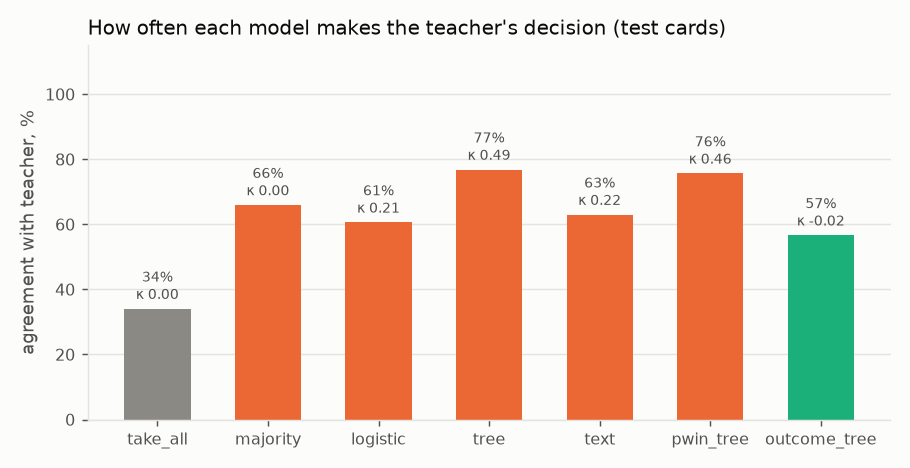
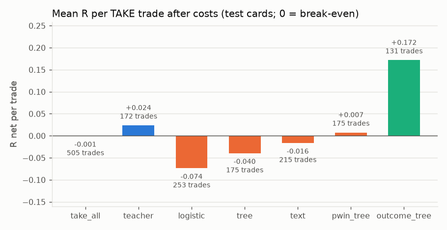
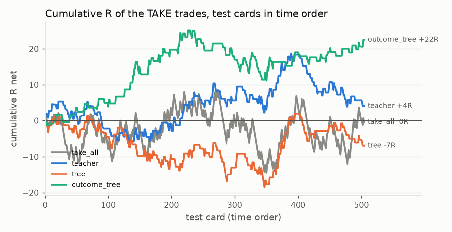
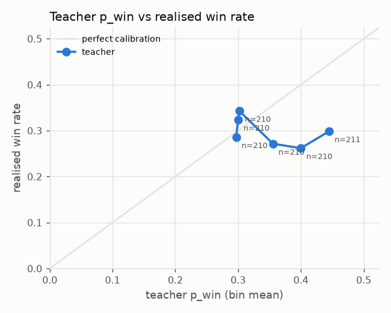
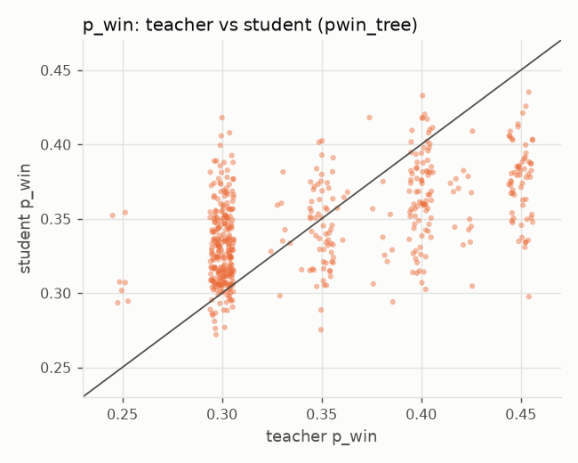

# Real data: gemini-2.5-flash-v1.1-think1024

Source: teacher-labelled cards imported with `vd import`.

Dataset fingerprint (sha256): `69a4f6d76604fc95e320cbe6edd19e21d031f55c5f9d67dc802eb1cfe984f9af`

Cards: 1261 teacher-labelled; students train on the earliest 60% of each group (751 cards, up to 2022-05-19) and are scored on the rest (505 cards). 5 training cards within one day of the split were purged, so no training outcome (20 bars = 5 hours) overlaps the test period. The teacher said TAKE on 39% of training cards.

| group | train | test |
|---|---|---|
| ADA | 378 | 253 |
| BTC | 373 | 252 |

**Small data.** With 505 test cards, a mean R per trade carries a standard error of roughly ±0.05–0.15 R (shown as ± below); differences smaller than that are noise.

**Import** (teacher run `gemini-2.5-flash-v1.1-think1024`):

| group | teacher lines | errors | answered signals | cards | joined |
|---|---|---|---|---|---|
| ADA | 632 | 0 | 632 | 6385 | 632 |
| BTC | 630 | 1 | 629 | 16740 | 629 |

**Teacher cutoff.** Every card predates the teacher's training cutoff (2025-01-31), so the teacher may have seen these months during training. Read these numbers as a method demonstration, not as clean out-of-sample evidence.

## Summary

- **Distillation:** the best student (`tree`) agrees with the teacher on 77% of test cards (Cohen's κ 0.49); always giving the teacher's most common answer agrees on 66%.
- **Speed:** teacher median 5,370 ms per card (one API call); `tree` 2.62 ms per card including training.
- **Usefulness:** taking every test signal earns -0.001 R per trade; the teacher's TAKE set +0.024 R; `tree` -0.040 R. The teacher beats taking everything, so there is something to distil.

## All decision makers (test cards)

| model | what it is | agreement | κ | TAKE | win rate | R net / trade | total R | ms / card |
|---|---|---|---|---|---|---|---|---|
| `take_all` | take every signal (no veto) | 34.1% | 0.00 | 505 (100%) | 31.3% | -0.001 ± 0.061 | -0.4 | – |
| `teacher` | the LLM's decisions | 100.0% | 1.00 | 172 (34%) | 32.0% | +0.024 ± 0.106 | +4.1 | 5,370.00 |
| `majority` | student: always the teacher's most common answer | 65.9% | 0.00 | 0 (0%) | – | – ± – | +0.0 | 0.00 |
| `logistic` | student: logistic regression on the card's numbers | 60.6% | 0.21 | 253 (50%) | 29.6% | -0.074 ± 0.085 | -18.7 | 0.04 |
| `tree` | student: gradient-boosted tree (depth 3) on the card's numbers | 76.8% | 0.49 | 175 (35%) | 30.9% | -0.040 ± 0.104 | -7.0 | 2.62 |
| `text` | student: char n-gram TF-IDF + logistic regression on the card text | 63.0% | 0.22 | 215 (43%) | 31.6% | -0.016 ± 0.094 | -3.5 | 2.15 |
| `pwin_tree` | student: tree regressing the teacher's p_win, then the teacher's rule | 75.6% | 0.46 | 175 (35%) | 32.0% | +0.007 ± 0.105 | +1.3 | 0.67 |
| `outcome_tree` | not a student: the same tree trained on real outcomes | 56.6% | -0.02 | 131 (26%) | 37.4% | +0.172 ± 0.124 | +22.5 | 0.58 |

`pwin_tree` reproduces the teacher's p_win with a mean absolute error of 0.039 and rank correlation 0.48.

Teacher ms / card is the API latency the teacher run logged; student ms / card is fit plus predict time on this machine divided by test cards, so it is an upper bound on inference time. R net ± is one standard error of the mean.

## Per group (test cards)

| group | cards | take all: R net / trade | teacher: TAKE | teacher: R net / trade |
|---|---|---|---|---|
| ADA | 253 | -0.028 | 89 | -0.053 |
| BTC | 252 | +0.027 | 83 | +0.106 |

## Is the teacher calibrated?

| teacher p_win (bin mean) | realised win rate | cards |
|---|---|---|
| 0.297 | 28.6% | 210 |
| 0.300 | 32.4% | 210 |
| 0.302 | 34.3% | 210 |
| 0.356 | 27.1% | 210 |
| 0.400 | 26.2% | 210 |
| 0.445 | 29.9% | 211 |

## Figures







## Example cards and teacher answers

```
Signal: SHORT, 15m bars. StochRSI K 97.5 -> 84.4 (turn out of overbought).
Volatility: ATR(14) = 0.91% of price; rank 42/100 over the last 30 days.
Cost: round-trip fee = 9% of the 1-ATR risk.
Trade plan: stop 1 ATR, take-profit 2 ATR, max 20 bars.
Trend: price vs EMA50 -1.96 ATR, vs EMA200 -3.61 ATR; EMA50 below EMA200.
Location: price vs daily VWAP -1.33 ATR; position in last 20 bars' range 37/100.
Last 4 bar moves (ATR, oldest first): +0.43, +0.16, -0.18, -0.81.
RSI(14) 42; volume 2.2x its 20-bar average.
Time: 09:00 UTC (Europe session).
Answer: TAKE or DONT_TAKE, win probability 0-1, reason in at most 40 words.
```
Teacher: **TAKE**, p_win 0.40. _Strong bearish trend, StochRSI turn from overbought, and high volume support a short. ATR rank and recent price action suggest good volatility for the 2R target. Expected R is positive._  
Outcome (never shown to any model): loss, R net -1.09.

```
Signal: LONG, 15m bars. StochRSI K 7.3 -> 29.8 (turn out of oversold).
Volatility: ATR(14) = 0.86% of price; rank 46/100 over the last 30 days.
Cost: round-trip fee = 9% of the 1-ATR risk.
Trade plan: stop 1 ATR, take-profit 2 ATR, max 20 bars.
Trend: price vs EMA50 -0.10 ATR, vs EMA200 -1.22 ATR; EMA50 below EMA200.
Location: price vs daily VWAP +0.40 ATR; position in last 20 bars' range 53/100.
Last 4 bar moves (ATR, oldest first): -0.40, +0.23, -0.08, +1.11.
RSI(14) 50; volume 0.8x its 20-bar average.
Time: 02:00 UTC (Asia session).
Answer: TAKE or DONT_TAKE, win probability 0-1, reason in at most 40 words.
```
Teacher: **TAKE**, p_win 0.38. _StochRSI turn from oversold, strong last bar, and positive VWAP location support the long. Despite bearish trend, the 2R target with 0.09R cost needs only 35% win rate._  
Outcome (never shown to any model): win, R net +1.90.

```
Signal: SHORT, 15m bars. StochRSI K 89.7 -> 88.4 (turn out of overbought).
Volatility: ATR(14) = 0.88% of price; rank 40/100 over the last 30 days.
Cost: round-trip fee = 9% of the 1-ATR risk.
Trade plan: stop 1 ATR, take-profit 2 ATR, max 20 bars.
Trend: price vs EMA50 -2.34 ATR, vs EMA200 -3.26 ATR; EMA50 below EMA200.
Location: price vs daily VWAP -0.87 ATR; position in last 20 bars' range 28/100.
Last 4 bar moves (ATR, oldest first): -0.16, +0.73, -0.08, -0.84.
RSI(14) 40; volume 1.3x its 20-bar average.
Time: 06:00 UTC (Asia session).
Answer: TAKE or DONT_TAKE, win probability 0-1, reason in at most 40 words.
```
Teacher: **DONT_TAKE**, p_win 0.30. _Bearish trend and location support the short, but the StochRSI signal is weak. Recent price action shows strong counter-trend moves. The required win rate of 36.3% is unlikely to be met._  
Outcome (never shown to any model): win, R net +1.91.

