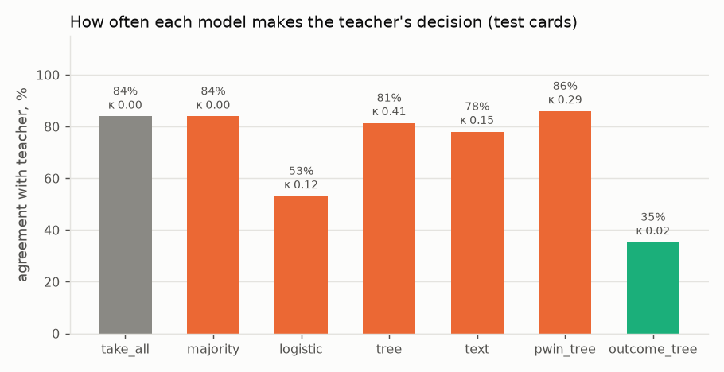
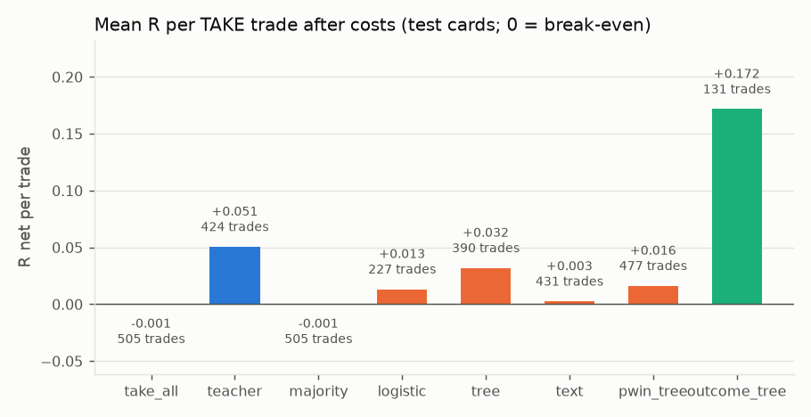
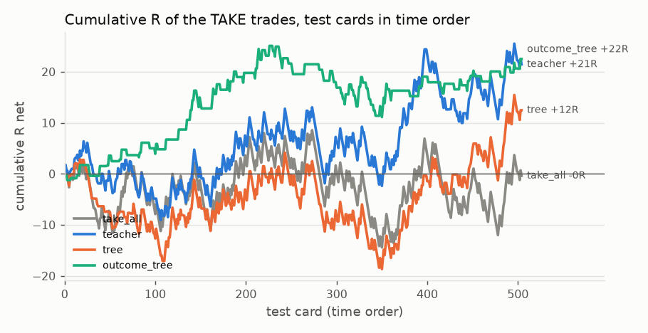
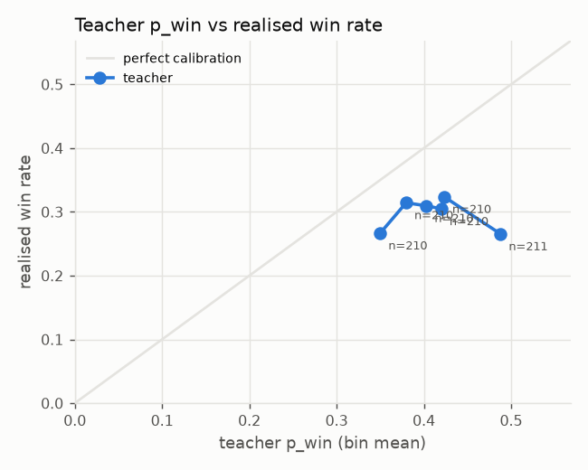
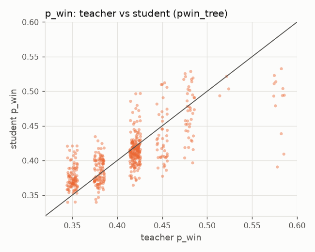

# Real data: gemini-2.5-flash-v2-think0

Source: teacher-labelled cards imported with `vd import`.

Dataset fingerprint (sha256): `7b0ac98d243a0a3cc1766c393e0a5c3214eb8ae1e186967625f113eafeed54ab`

Cards: 1261 teacher-labelled; students train on the earliest 60% of each group (751 cards, up to 2022-05-19) and are scored on the rest (505 cards). 5 training cards within one day of the split were purged, so no training outcome (20 bars = 5 hours) overlaps the test period. The teacher said TAKE on 89% of training cards.

| group | train | test |
|---|---|---|
| ADA | 378 | 253 |
| BTC | 373 | 252 |

**Small data.** With 505 test cards, a mean R per trade carries a standard error of roughly ±0.05–0.15 R (shown as ± below); differences smaller than that are noise.

**Import** (teacher run `gemini-2.5-flash-v2-think0`):

| group | teacher lines | errors | answered signals | cards | joined |
|---|---|---|---|---|---|
| ADA | 633 | 1 | 632 | 6385 | 632 |
| BTC | 629 | 0 | 629 | 16740 | 629 |

**Teacher cutoff.** Every card predates the teacher's training cutoff (2025-01-31), so the teacher may have seen these months during training. Read these numbers as a method demonstration, not as clean out-of-sample evidence.

## Summary

- **Distillation:** the best student (`tree`) agrees with the teacher on 81% of test cards (Cohen's κ 0.41); always giving the teacher's most common answer agrees on 84%.
- **Speed:** teacher median 1,070 ms per card (one API call); `tree` 3.04 ms per card including training.
- **Usefulness:** taking every test signal earns -0.001 R per trade; the teacher's TAKE set +0.051 R; `tree` +0.032 R. The teacher beats taking everything, so there is something to distil.

## All decision makers (test cards)

| model | what it is | agreement | κ | TAKE | win rate | R net / trade | total R | ms / card |
|---|---|---|---|---|---|---|---|---|
| `take_all` | take every signal (no veto) | 84.0% | 0.00 | 505 (100%) | 31.3% | -0.001 ± 0.061 | -0.4 | – |
| `teacher` | the LLM's decisions | 100.0% | 1.00 | 424 (84%) | 33.3% | +0.051 ± 0.068 | +21.4 | 1,070.00 |
| `majority` | student: always the teacher's most common answer | 84.0% | 0.00 | 505 (100%) | 31.3% | -0.001 ± 0.061 | -0.4 | 0.00 |
| `logistic` | student: logistic regression on the card's numbers | 53.1% | 0.12 | 227 (45%) | 32.6% | +0.013 ± 0.093 | +3.0 | 0.09 |
| `tree` | student: gradient-boosted tree (depth 3) on the card's numbers | 81.4% | 0.41 | 390 (77%) | 32.6% | +0.032 ± 0.070 | +12.5 | 3.04 |
| `text` | student: char n-gram TF-IDF + logistic regression on the card text | 78.0% | 0.15 | 431 (85%) | 32.0% | +0.003 ± 0.067 | +1.1 | 2.26 |
| `pwin_tree` | student: tree regressing the teacher's p_win, then the teacher's rule | 85.9% | 0.29 | 477 (94%) | 31.9% | +0.016 ± 0.063 | +7.7 | 0.43 |
| `outcome_tree` | not a student: the same tree trained on real outcomes | 35.2% | 0.02 | 131 (26%) | 37.4% | +0.172 ± 0.124 | +22.5 | 0.51 |

`pwin_tree` reproduces the teacher's p_win with a mean absolute error of 0.023 and rank correlation 0.72.

Teacher ms / card is the API latency the teacher run logged; student ms / card is fit plus predict time on this machine divided by test cards, so it is an upper bound on inference time. R net ± is one standard error of the mean.

## Per group (test cards)

| group | cards | take all: R net / trade | teacher: TAKE | teacher: R net / trade |
|---|---|---|---|---|
| ADA | 253 | -0.028 | 229 | +0.017 |
| BTC | 252 | +0.027 | 195 | +0.090 |

## Is the teacher calibrated?

| teacher p_win (bin mean) | realised win rate | cards |
|---|---|---|
| 0.350 | 26.7% | 210 |
| 0.380 | 31.4% | 210 |
| 0.403 | 31.0% | 210 |
| 0.420 | 30.5% | 210 |
| 0.423 | 32.4% | 210 |
| 0.488 | 26.5% | 211 |

## Figures







## Example cards and teacher answers

```
Signal: SHORT, 15m bars. StochRSI K 89.7 -> 88.4 (turn out of overbought).
Volatility: ATR(14) = 0.88% of price; rank 40/100 over the last 30 days.
Cost: round-trip fee = 9% of the 1-ATR risk.
Trade plan: stop 1 ATR, take-profit 2 ATR, max 20 bars.
Trend: price vs EMA50 -2.34 ATR, vs EMA200 -3.26 ATR; EMA50 below EMA200.
Location: price vs daily VWAP -0.87 ATR; position in last 20 bars' range 28/100.
Last 4 bar moves (ATR, oldest first): -0.16, +0.73, -0.08, -0.84.
RSI(14) 40; volume 1.3x its 20-bar average.
Time: 06:00 UTC (Asia session).
Answer: TAKE or DONT_TAKE, win probability 0-1, reason in at most 40 words.
```
Teacher: **TAKE**, p_win 0.38. _Strong downtrend, price below key EMAs and VWAP, and low range position suggest bearish momentum. However, the StochRSI turn is weak, and the last bar was a significant down move, potentially exhausting sellers._  
Outcome (never shown to any model): win, R net +1.91.

```
Signal: SHORT, 15m bars. StochRSI K 98.1 -> 93.0 (turn out of overbought).
Volatility: ATR(14) = 0.91% of price; rank 51/100 over the last 30 days.
Cost: round-trip fee = 9% of the 1-ATR risk.
Trade plan: stop 1 ATR, take-profit 2 ATR, max 20 bars.
Trend: price vs EMA50 +0.69 ATR, vs EMA200 -0.16 ATR; EMA50 below EMA200.
Location: price vs daily VWAP +1.97 ATR; position in last 20 bars' range 91/100.
Last 4 bar moves (ATR, oldest first): +1.13, -0.15, +0.38, -0.36.
RSI(14) 58; volume 0.1x its 20-bar average.
Time: 09:00 UTC (Europe session).
Answer: TAKE or DONT_TAKE, win probability 0-1, reason in at most 40 words.
```
Teacher: **TAKE**, p_win 0.38. _Weak signal (StochRSI turn from overbought, but not extreme), low volume, and conflicting trend/location suggest a lower win probability. Price is high in range, but EMA50 below EMA200._  
Outcome (never shown to any model): win, R net +1.91.

```
Signal: LONG, 15m bars. StochRSI K 12.1 -> 20.8 (turn out of oversold).
Volatility: ATR(14) = 0.89% of price; rank 37/100 over the last 30 days.
Cost: round-trip fee = 9% of the 1-ATR risk.
Trade plan: stop 1 ATR, take-profit 2 ATR, max 20 bars.
Trend: price vs EMA50 -2.77 ATR, vs EMA200 -4.77 ATR; EMA50 below EMA200.
Location: price vs daily VWAP -2.56 ATR; position in last 20 bars' range 24/100.
Last 4 bar moves (ATR, oldest first): -1.85, -0.84, +0.71, +0.36.
RSI(14) 37; volume 0.5x its 20-bar average.
Time: 12:00 UTC (Europe session).
Answer: TAKE or DONT_TAKE, win probability 0-1, reason in at most 40 words.
```
Teacher: **DONT_TAKE**, p_win 0.35. _Strong downtrend, low volume, and price far below key moving averages and VWAP suggest limited upside. StochRSI turn is a weak signal against this backdrop._  
Outcome (never shown to any model): loss, R net -1.09.

