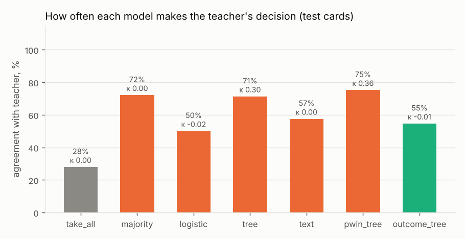
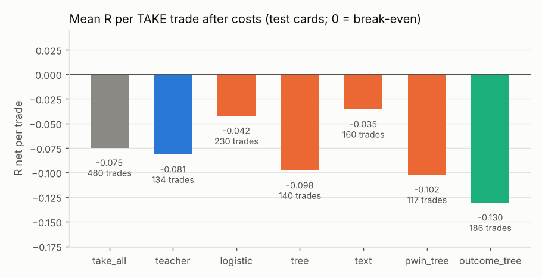
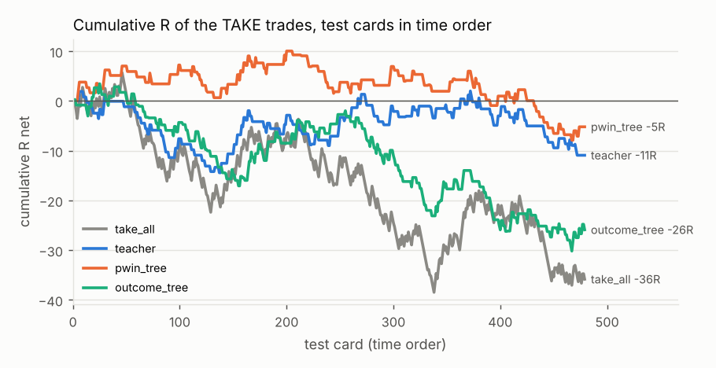
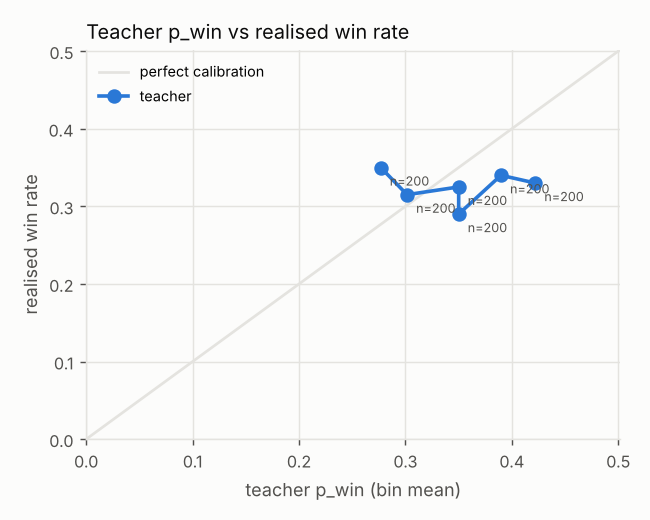
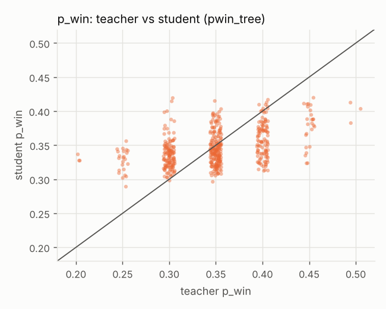

# Distillation run — SYNTHETIC demo data

Source: synthetic cards and a hand-written heuristic teacher (`veto_distill.synthetic`); no market data, no LLM. Numbers here only show the pipeline works.

Cards: 1200 teacher-labelled; students train on the earliest 60% of each group (708 cards, up to 2022-02-21) and are scored on the rest (480 cards). 12 training cards within one day of the split were purged, so no training outcome (20 bars = 5 hours) overlaps the test period. The teacher said TAKE on 31% of training cards.

| group | train | test |
|---|---|---|
| A | 354 | 240 |
| B | 354 | 240 |

**Small data.** With 480 test cards, a mean R per trade carries a standard error of roughly ±0.05–0.15 R (shown as ± below); differences smaller than that are noise.

## Summary

- **Distillation:** the best student (`pwin_tree`) reaches Cohen's κ 0.36 against the teacher (0 = chance, 1 = perfect copy), with raw agreement 75%. Raw agreement is inflated by the teacher's 28% TAKE rate on test cards: always giving its most common answer already agrees on 72%.
- **Speed:** teacher median 1,260 ms per card (one API call); `pwin_tree` 0.37 ms per card including training.
- **Usefulness:** taking every test signal earns -0.075 R per trade. The teacher's TAKE set differs from that by -0.007 ± 0.100 (-0.1 SE), `pwin_tree` by +0.030 ± 0.114 (+0.3 SE) (paired bootstrap SE). Neither the teacher nor any student shows a measurable difference from taking every signal, so there is no edge to distil.
- **Calibration:** the teacher's p_win averages 0.35 against a realised win rate of 32% (p_win bins 0.28–0.42, realised win rates 29%–35%), overconfident by 2 points. Its p_win ranks wins with AUC 0.50 (0.5 = no ranking). A probability that does not rank outcomes gives a student nothing useful to copy.

## All decision makers (test cards)

| model | what it is | κ | agreement | TAKE | win rate | R net / trade | Δ vs take all (paired SE) | total R | ms / card |
|---|---|---|---|---|---|---|---|---|---|
| `take_all` | take every signal (no veto) | 0.00 | 27.9% | 480 (100%) | 29.6% | -0.075 ± 0.061 | – | -35.8 | – |
| `teacher` | the LLM's decisions | 1.00 | 100.0% | 134 (28%) | 29.9% | -0.081 ± 0.117 | -0.007 ± 0.100 (-0.1 SE) | -10.9 | 1,260.00 |
| `majority` | student: always the teacher's most common answer | 0.00 | 72.1% | 0 (0%) | – | – ± – | – | +0.0 | 0.00 |
| `logistic` | student: logistic regression on the card's numbers | -0.00 | 50.0% | 238 (50%) | 30.7% | -0.053 ± 0.088 | +0.022 ± 0.061 (+0.4 SE) | -12.6 | 0.04 |
| `tree` | student: gradient-boosted tree (depth 3) on the card's numbers | 0.27 | 69.6% | 152 (32%) | 30.3% | -0.062 ± 0.109 | +0.013 ± 0.089 (+0.1 SE) | -9.4 | 4.09 |
| `text` | student: char n-gram TF-IDF + logistic regression on the card text | -0.01 | 57.1% | 160 (33%) | 30.0% | -0.039 ± 0.105 | +0.036 ± 0.084 (+0.4 SE) | -6.2 | 1.42 |
| `pwin_tree` | student: tree regressing the teacher's p_win, then the teacher's rule | 0.36 | 75.4% | 116 (24%) | 31.0% | -0.045 ± 0.126 | +0.030 ± 0.114 (+0.3 SE) | -5.2 | 0.37 |
| `outcome_tree` | not a student: the same tree trained on real outcomes | 0.02 | 55.6% | 189 (39%) | 28.0% | -0.137 ± 0.096 | -0.062 ± 0.076 (-0.8 SE) | -25.9 | 0.27 |

No decision maker earns a positive mean R per trade on the test cards.

`pwin_tree` reproduces the teacher's p_win with a mean absolute error of 0.036 and rank correlation 0.34.

Teacher ms / card is the API latency the teacher run logged; student ms / card is fit plus predict time on this machine divided by test cards, so it is an upper bound on inference time. R net ± is one standard error of the mean. Δ vs take all is the TAKE set's mean R minus every test card's mean R, with a paired bootstrap standard error (the TAKE set is a subset of the same cards); a difference counts as measurable only beyond about 2 SE.

**Window.** Test cards run from 2022-02-22 to 2022-03-29: the latest 40% of the teacher-labelled cards, a later and shorter window than any score computed on all of them. Taking every card over the whole dataset, for comparison:

| group | cards | win rate | R net / trade |
|---|---|---|---|
| A | 600 | 35.5% | +0.082 ± 0.057 |
| B | 600 | 29.5% | -0.051 ± 0.054 |
| all | 1200 | 32.5% | +0.015 ± 0.039 |

## Per group (test cards)

| group | cards | take all: R net / trade | teacher: TAKE | teacher: R net / trade |
|---|---|---|---|---|
| A | 240 | -0.099 | 68 | -0.035 |
| B | 240 | -0.051 | 66 | -0.130 |

## Is the teacher calibrated?

| teacher p_win (bin mean) | realised win rate | cards |
|---|---|---|
| 0.277 | 35.0% | 200 |
| 0.301 | 31.5% | 200 |
| 0.350 | 32.5% | 200 |
| 0.350 | 29.0% | 200 |
| 0.390 | 34.0% | 200 |
| 0.422 | 33.0% | 200 |

## Figures







## Example cards and teacher answers

```
Signal: LONG, 15m bars. StochRSI K 7.5 -> 18.7 (turn out of oversold).
Volatility: ATR(14) = 0.48% of price; rank 36/100 over the last 30 days.
Cost: round-trip fee = 10% of the 1-ATR risk.
Trade plan: stop 1 ATR, take-profit 2 ATR, max 20 bars.
Trend: price vs EMA50 +0.52 ATR, vs EMA200 -1.51 ATR; EMA50 above EMA200.
Location: price vs daily VWAP -0.14 ATR; position in last 20 bars' range 69/100.
Last 4 bar moves (ATR, oldest first): +0.72, -0.43, -0.21, +0.69.
RSI(14) 22; volume 1.9x its 20-bar average.
Time: 05:00 UTC (Asia session).
Answer: TAKE or DONT_TAKE, win probability 0-1, reason in at most 40 words.
```
Teacher: **TAKE**, p_win 0.45. _trend supports the direction; RSI stretched; volume confirms; fee heavy._  
Outcome (never shown to any model): loss, R net -1.10.

```
Signal: LONG, 15m bars. StochRSI K 0.0 -> 10.8 (turn out of oversold).
Volatility: ATR(14) = 0.34% of price; rank 23/100 over the last 30 days.
Cost: round-trip fee = 10% of the 1-ATR risk.
Trade plan: stop 1 ATR, take-profit 2 ATR, max 20 bars.
Trend: price vs EMA50 +3.47 ATR, vs EMA200 +7.24 ATR; EMA50 below EMA200.
Location: price vs daily VWAP -1.29 ATR; position in last 20 bars' range 57/100.
Last 4 bar moves (ATR, oldest first): -0.50, -0.56, +0.32, -0.41.
RSI(14) 29; volume 0.5x its 20-bar average.
Time: 17:00 UTC (US session).
Answer: TAKE or DONT_TAKE, win probability 0-1, reason in at most 40 words.
```
Teacher: **TAKE**, p_win 0.40. _trend supports the direction; RSI stretched; fee heavy._  
Outcome (never shown to any model): win, R net +1.90.

```
Signal: SHORT, 15m bars. StochRSI K 82.5 -> 76.3 (turn out of overbought).
Volatility: ATR(14) = 0.28% of price; rank 42/100 over the last 30 days.
Cost: round-trip fee = 10% of the 1-ATR risk.
Trade plan: stop 1 ATR, take-profit 2 ATR, max 20 bars.
Trend: price vs EMA50 +1.47 ATR, vs EMA200 +0.34 ATR; EMA50 above EMA200.
Location: price vs daily VWAP +0.15 ATR; position in last 20 bars' range 6/100.
Last 4 bar moves (ATR, oldest first): +0.63, -1.11, -0.49, -0.45.
RSI(14) 56; volume 1.1x its 20-bar average.
Time: 07:00 UTC (Asia session).
Answer: TAKE or DONT_TAKE, win probability 0-1, reason in at most 40 words.
```
Teacher: **DONT_TAKE**, p_win 0.25. _against the EMA50 trend; fee heavy._  
Outcome (never shown to any model): win, R net +1.90.

